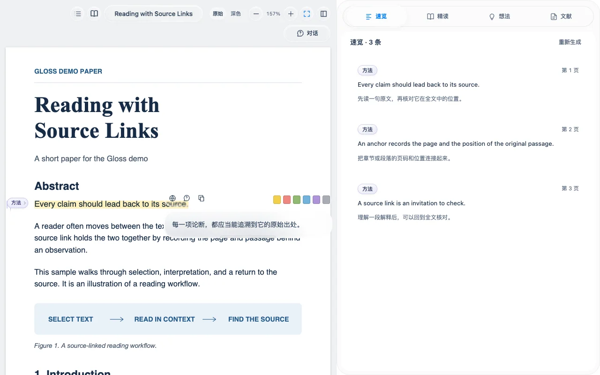

  

<h1 align="center">Gloss Paper Reader</h1>

<strong>Gloss 是一款面向 DeepSeek Harness 的 AI 辅助论文阅读插件。</strong> 
划词翻译、章节精读、原文定位。

An AI-assisted academic PDF reader for DeepSeek Harness. 
Contextual translation, chapter navigation, and Zotero integration.

  <a href="https://hh1802-npu.github.io/Gloss-Paper-Reader/">🌐 官网与在线体验</a> ·
  <a href="#下载">⬇️ 下载 Gloss</a> ·
  <a href="docs/INSTALL.md">📦 安装指南</a>

## ✨ 读论文时能做什么

- **划词就能读译文。** 遇到难句，选中原文，也可以接着问。
- **顺着章节读。** 逐章精读、做高亮，点一下回到原文核对。
- **和 AI 一起想。** 在「想法」里围绕当前论文讨论。
- **把论文收在一起。** 导入 Zotero 附件，按题名或 DOI 查找文献。

## 下载

🍎 Gloss 的原生开发环境是 **macOS**，目前提供 Apple Silicon 安装包。

🪟 **Windows x64** 也可以配置，适配仍在努力优化中。

| 平台 | 安装包 | 解压后运行 |
| --- | --- | --- |
| macOS · Apple Silicon | [下载 ZIP](https://github.com/Hh1802-NPU/Gloss-Paper-Reader/releases/download/v1.0.0/Gloss-1.0.0-macos-arm64.zip) | `Configure-Gloss.command` |
| Windows · x64 | [下载 ZIP](https://github.com/Hh1802-NPU/Gloss-Paper-Reader/releases/download/v1.0.0/Gloss-1.0.0-windows-x64.zip) | `Configure-Gloss.cmd` |

运行配置脚本后，在 DeepSeek Harness 的插件页安装并启用解压出来的 `Gloss` 本地组合包。 [完整安装指南](docs/INSTALL.md)

💬 让 DeepSeek 帮你操作

把下面这段发给 DeepSeek Harness 中能操作本机的 Agent。

> 请帮我在 DeepSeek Harness 中配置 Gloss-Paper-Reader。
>
> https://github.com/Hh1802-NPU/Gloss-Paper-Reader

## 🧩 开发与许可

想了解源码或运行检查，可以从[开发指南](docs/DEVELOPMENT.md)开始。Gloss 自有代码采用 [MIT 许可证](LICENSE)。 [第三方组件与许可](docs/THIRD_PARTY.md)
